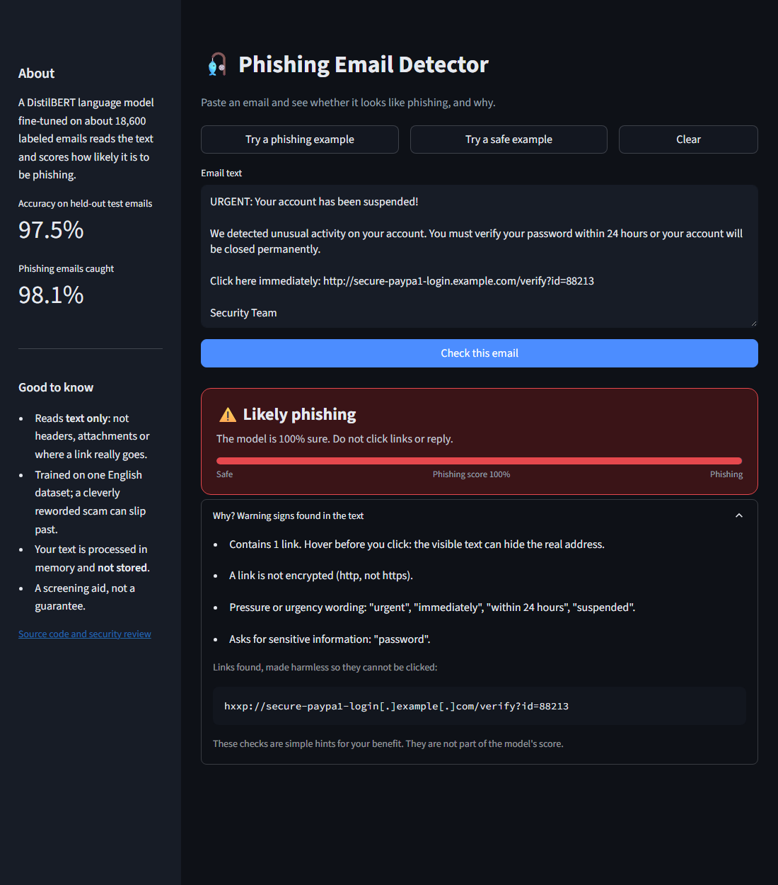
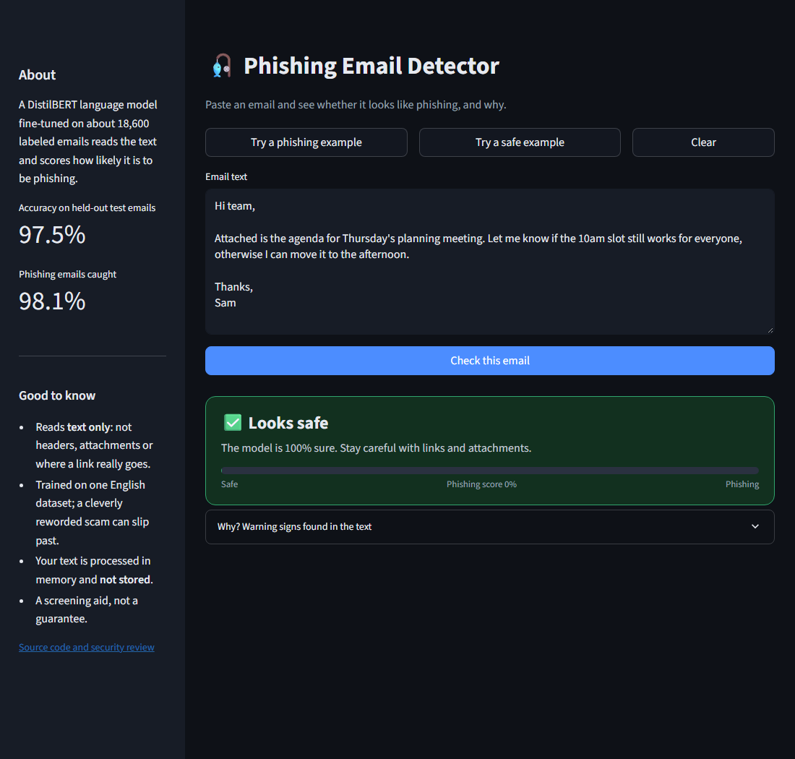
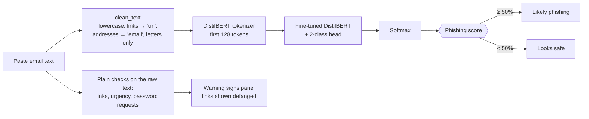
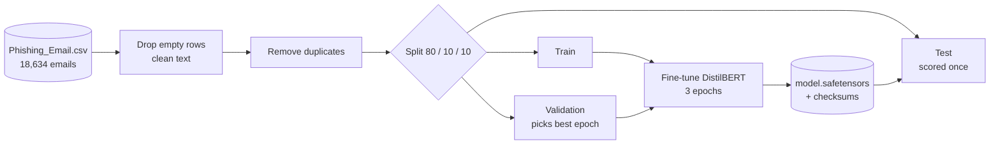
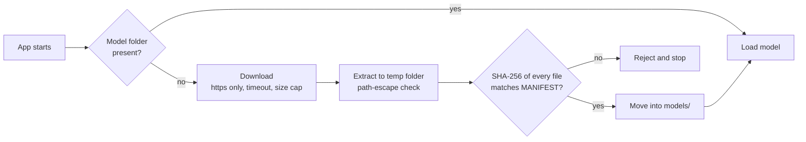

# 🎣 AI Phishing Detector

Paste the text of an email and find out whether it looks like **phishing**, and *why*. A DistilBERT language model, fine-tuned on about 18,600 labeled emails, scores the text; the app also points out the warning signs a person can check (urgent wording, odd links, requests for passwords).

[](https://codespaces.new/aurveus/AI-phishing-detector)
[](https://huggingface.co/spaces/aurveus/Ai-Phishing-Detector)


| Phishing email | Normal email |
|---|---|
|  |  |

> A screening aid, not a guarantee. It reads text only: it does not inspect headers, attachments or where a link really goes.

## Try it

| Way | Cost | How |
|---|---|---|
| **Live demo** | free | Open the Hugging Face badge above. The first load takes a minute while the model downloads. |
| **GitHub Codespaces** | free tier | Click the Codespaces badge → *Create codespace*. It installs everything and opens the app in your browser by itself. (GitHub's free monthly allowance applies to your account.) |
| **Docker** | free | `docker build -t phishing-detector . && docker run -p 8501:8501 phishing-detector`, then open http://localhost:8501 |
| **Locally** | free | See [Quick start](#quick-start). |

Every way has *Try a phishing example* and *Try a safe example* buttons, so you can see it work without pasting anything. A direct link such as `?example=phishing` opens the app with that example already checked.

## At a glance

| | |
|---|---|
| **Model** | `distilbert-base-uncased` fine-tuned for 2 classes (safe / phishing) |
| **Data** | 18,634 emails: 11,322 safe, 7,312 phishing |
| **Accuracy** | **97.5%** on the held-out test split (98.3% when test emails that also appear in training are removed) |
| **Phishing recall** | 98.1%: 29 of 1,518 phishing emails missed in the test split |
| **App** | Streamlit, runs anywhere, nothing stored |

## How it works



The same cleaning step runs in training, evaluation and the app. This matters: the model learned from cleaned text, so feeding it raw text measurably lowers recall (see [results](#results)). The warning-signs panel is separate from the model: simple, readable checks shown next to the verdict, and they never change its score.

### Training pipeline



### Safe model download

The trained model (257 MB) is not in git. On first start the app fetches it, and refuses to use anything that does not match the recorded checksums:



## Results

Measured by `python -m phishing_detector.evaluate` on the saved model, using the 20% test split it was originally held out with (n = 3,727):

| Setting | Accuracy | Precision | Recall | Missed phishing | False alarms |
|---|---|---|---|---|---|
| **App as shipped now** (cleaned text, 128 tokens) | **97.45%** | 95.8% | 98.1% | 29 | 66 |
| Same, without test emails that also appear in training (n = 3,343) | 98.29% | 97.7% | 97.9% | 27 | 30 |
| Original app behaviour (raw text, 512 tokens) | 97.13% | 96.0% | 97.0% | 45 | 62 |

Honest caveats, explained in [docs/SECURITY_AND_REVIEW.md](docs/SECURITY_AND_REVIEW.md): the original training run used the test set to pick the best epoch, and 10% of test emails also appear in the training data. Removing those duplicates does not lower the score, so the headline result holds, but a clean three-way split is what `train.py` now does. The data is one public dataset, so expect lower accuracy on emails that look different from it.

## Quick start

```bash
git clone https://github.com/aurveus/AI-phishing-detector.git
cd AI-phishing-detector
python -m venv venv && source venv/bin/activate     # Windows: venv\Scripts\activate
pip install -r requirements.txt
streamlit run app.py                                 # downloads and verifies the model on first start
```

Train or evaluate yourself (needs the dataset, see [data/README.md](data/README.md)):

```bash
pip install -r requirements-train.txt
python -m phishing_detector.train                    # fine-tune and save to models/
python -m phishing_detector.evaluate                 # print the results table above
python -m unittest discover -s tests -v              # 12 tests, including clicking through the real UI
```

## Project layout

```
app.py                     Streamlit web app (entry point)
Dockerfile                 container image (non-root, CPU-only PyTorch)
.devcontainer/             one-click GitHub Codespaces setup
.streamlit/config.toml     theme and UI settings
phishing_detector/
  config.py                paths, limits, model URL (all overridable with environment variables)
  preprocess.py            clean_text, shared by training, evaluation and the app
  classifier.py            loads the model once, predicts with a confidence score
  signals.py               plain-language warning signs and defanged links
  examples.py              the sample emails behind the "try an example" buttons
  model_store.py           safe download: https, size cap, no zip-slip, SHA-256 check
  data.py                  dataset loading and the train/test split
  train.py                 fine-tuning script (validation set, de-duplicated, runs on CPU or GPU)
  evaluate.py              scores the saved model
tests/                     unit tests, download-safety tests, and a click-through test of the UI
models/                    model folder (created at first run) + MANIFEST.sha256
data/                      put Phishing_Email.csv here (not in git)
docs/                      security review and screenshots
```

## Security

The code and dependencies were reviewed; the findings, fixes and remaining limits are in [docs/SECURITY_AND_REVIEW.md](docs/SECURITY_AND_REVIEW.md). In short: known-vulnerable dependency versions were upgraded (81 known issues down to none), the model download is verified, inputs are size-limited, links in results are shown defanged and unclickable, the container runs as a normal user, and the model file format (`safetensors`) cannot run code on load.

## Limitations

- Reads text only: no headers, sender reputation, attachments or link destinations.
- Trained on one English dataset; a determined attacker can rewrite a message to slip past it.
- A confidence score is not a probability you should bet on; treat 90% and 99% the same way: be careful.

## Built with

Python, PyTorch, Hugging Face Transformers (DistilBERT), scikit-learn, pandas, Streamlit.
