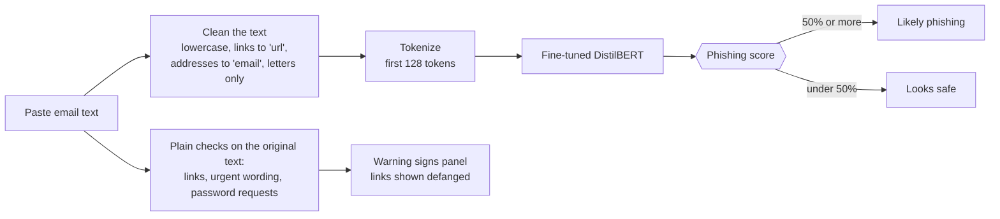
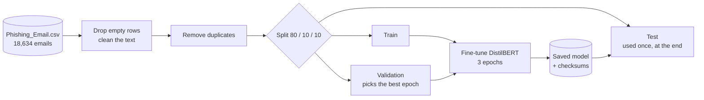
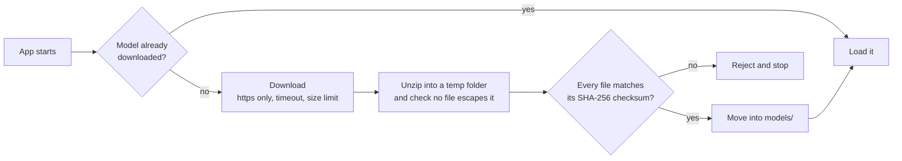

# AI Phishing Detector

Paste in an email and this app tells you whether it looks like phishing, and shows you the warning signs it spotted along the way. Under the hood it's a DistilBERT model I fine-tuned on about 18,600 labeled emails, wrapped in a small Streamlit web app.

[](https://codespaces.new/aurveus/AI-phishing-detector)
[](https://huggingface.co/spaces/aurveus/Ai-Phishing-Detector)

| A phishing email | A normal email |
|---|---|
|  |  |

It's a screening aid, not a guarantee. It only reads the text of an email. It can't see headers or attachments, or tell where a link really leads.

## Try it

The easiest way is the live demo (the Hugging Face badge above). The first load takes a minute while the model downloads.

If you'd rather run it yourself, any of these work and none of them cost anything:

- **Codespaces:** click the badge, choose *Create codespace*, and wait. It installs everything and opens the app in your browser. It runs on GitHub's free monthly allowance.
- **Docker:** `docker build -t phishing-detector . && docker run -p 8501:8501 phishing-detector`, then open http://localhost:8501
- **On your machine:** see [Run it locally](#run-it-locally) below.

The app has two buttons, *Try a phishing example* and *Try a safe example*, so you can see how it behaves without pasting anything. A link ending in `?example=phishing` opens it with that example already checked.

## How well does it work?

On the part of the dataset it never trained on (3,727 emails), it gets 97.5% right and catches 98.1% of the phishing emails. It missed 29 of the 1,518 phishing emails and raised 66 false alarms.

| | Accuracy | Phishing caught | Missed | False alarms |
|---|---|---|---|---|
| The app as it is now | 97.5% | 98.1% | 29 | 66 |
| Same, leaving out test emails that also appear in the training data (3,343 left) | 98.3% | 97.9% | 27 | 30 |
| How the first version of the app fed it text (uncleaned, longer) | 97.1% | 97.0% | 45 | 62 |

You can reproduce this with `python -m phishing_detector.evaluate`.

Two things to know about these numbers. The original training run used the test set to choose its best epoch, and about 10% of the test emails also show up in the training data, so the score could be a little flattering. I checked: leaving those duplicates out doesn't make it worse (it actually looks slightly better), so the result holds up. The newer `train.py` splits the data properly. I haven't retrained the published model with it, though. Also, all of this comes from one public dataset, so expect it to do worse on emails that look very different from it.

## How it works

When you paste an email, the text gets cleaned up the same way the training data was (lowercase, links turned into the word "url", addresses into "email", everything but letters dropped). Then the model reads the first 128 tokens and gives a phishing score. Separately, some plain checks look at the original text for things a person can verify: links, pushy wording, requests for passwords. Those never change the score; they just help you see why.



The cleaning step is shared between training, evaluation and the app. That matters more than it sounds. The first version of the app skipped it, and the model missed noticeably more phishing emails as a result.

### Training



### Getting the model safely

The trained model is 257 MB, so it isn't stored in git. The first time the app starts it downloads the model, and it won't use anything that doesn't match the checksums stored in the repo.



## Run it locally

```bash
git clone https://github.com/aurveus/AI-phishing-detector.git
cd AI-phishing-detector
python -m venv venv
source venv/bin/activate        # on Windows: venv\Scripts\activate
pip install -r requirements.txt
streamlit run app.py
```

## Train it yourself

You'll need the dataset, which isn't in the repo (it's 52 MB). It's the public "Phishing Email Detection" dataset on Kaggle, a file called `Phishing_Email.csv` with the columns `Email Text` and `Email Type`. Put it at `data/Phishing_Email.csv`, or point `DATA_CSV` at wherever it lives.

```bash
pip install -r requirements-train.txt
python -m phishing_detector.train        # fine-tunes the model and saves it to models/
python -m phishing_detector.evaluate     # prints the results table above
python -m unittest discover -s tests     # 12 tests, including clicking through the real UI
```

## What's in here

```
app.py                  the Streamlit app
Dockerfile              container image (non-root, CPU-only PyTorch)
.devcontainer/          the one-click Codespaces setup
.streamlit/config.toml  theme and UI settings
phishing_detector/
  config.py             paths, limits and the model URL (all overridable with environment variables)
  preprocess.py         the text cleaning shared by training, evaluation and the app
  classifier.py         loads the model once and scores text
  signals.py            the plain-language warning signs and defanged links
  examples.py           the sample emails behind the example buttons
  model_store.py        the safe download
  model.sha256          checksums of the model files
  data.py               loads the dataset and splits it
  train.py              fine-tuning
  evaluate.py           scores the saved model
tests/                  unit tests, download-safety tests, and a click-through test of the UI
scripts/deploy_space.sh publishes to a free Hugging Face Space
docs/                   the security review and screenshots
```

## Security

I went through the code, the dependencies and the git history. The short version: the old pinned dependencies had 81 known vulnerabilities and are now upgraded, the model download is verified, input size is limited, links in results are shown unclickable, the container doesn't run as root, and the model is stored as `safetensors`, a format that can't run code when it's loaded. The full list of what I found, what I fixed and what's still open is in [docs/SECURITY_AND_REVIEW.md](docs/SECURITY_AND_REVIEW.md).

## Limitations

- It only reads text. No headers, sender reputation, attachments or link destinations.
- It was trained on one English dataset, and someone determined can reword a message until it slips through.
- Its confidence score isn't a real probability. Whether it says 90% or 99%, be careful either way.

Built with Python, PyTorch, Hugging Face Transformers, scikit-learn, pandas and Streamlit.
